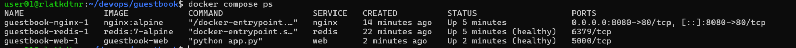

# 7주차 도커 컴포즈

## docker sompose ps 결과

## scale 후 각 웹 컨테이너 호스트명(컨테이너 ID)이 바뀐 화면 결과

## down 후 up과 down -v 후 up 차이 비교
down 후 up은 볼륨을 삭제하지 않기 때문에 컨테이너를 다시 실행해도 방명록 글이 유지되지만 down -v 후 up은 기존 redis데이터가 삭제되어서 방명록 글이 사라진다.

## .env를 Git에 올리지 않는 이유
.env에 redis비밀번호가 저장되어있기 때문에 .env를 git에 올리면 비밀번호가 외부에 노출될 수 있다.

docker compose ps 결과와 scale 후 각 웹 컨테이너 호스트명이 바뀐 화면 결과는 캡쳐로 첨부
